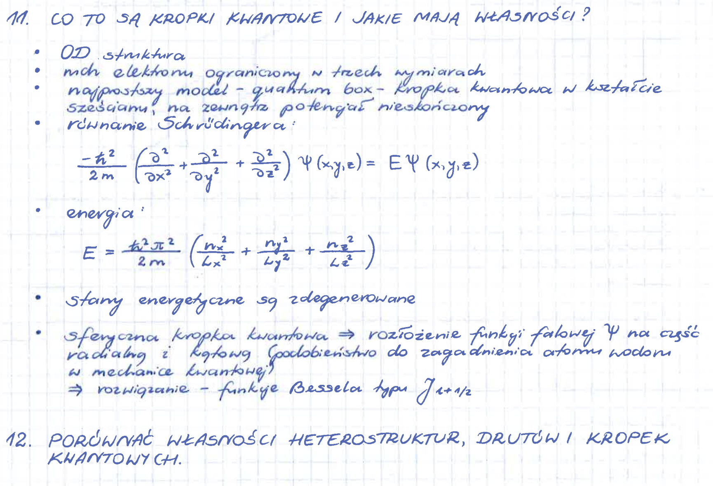

# Transkrypcja notatek z mechaniki kwantowej

## 1. Oryginalne notatki

Poniższy obraz przedstawia odręczne notatki dotyczące kropek kwantowych oraz struktur o obniżonej wymiarowości.



## 2. Prompt wykorzystany do transkrypcji

```text
Przepisz odręczne notatki z załączonego obrazu
do formatu Markdown w języku polskim.

Zachowaj oryginalną numerację zagadnień,
strukturę tekstu oraz znaczenie fizyczne.

Wszystkie równania matematyczne zapisz
w notacji LaTeX, stosując składnię zgodną
z GitHub Markdown.

Sprawdź poprawność fizyczną i matematyczną
notatek. Popraw błędy merytoryczne,
nie zmieniając zasadniczego znaczenia tekstu.

Uzupełnij zagadnienia, które zostały
w notatkach jedynie zasygnalizowane.

Przygotuj przejrzystą, poprawioną wersję
notatki w języku polskim.
```

## 3. Finalna poprawiona notatka

### 11. Co to są kropki kwantowe i jakie mają właściwości?

**Kropki kwantowe** (*quantum dots*) to nanostruktury, w których ruch nośników ładunku jest ograniczony we wszystkich trzech wymiarach przestrzennych.

W idealizowanym modelu można rozpatrywać elektron zamknięty w trójwymiarowej studni potencjału o nieskończenie wysokich ścianach.

#### 11.1. Równanie Schrödingera

Dla cząstki wewnątrz studni, gdzie potencjał wynosi zero, stacjonarne równanie Schrödingera przyjmuje postać:

```math
-\frac{\hbar^2}{2m}
\left(
\frac{\partial^2}{\partial x^2}
+
\frac{\partial^2}{\partial y^2}
+
\frac{\partial^2}{\partial z^2}
\right)
\psi(x,y,z)
=
E\psi(x,y,z)
```

gdzie:

- $\hbar$ – zredukowana stała Plancka,
- $m$ – masa cząstki,
- $\psi(x,y,z)$ – przestrzenna funkcja falowa,
- $E$ – energia cząstki.

Dla nieskończonej studni potencjału funkcja falowa musi znikać na jej ścianach.

#### 11.2. Poziomy energetyczne

Dla prostopadłościennej studni potencjału o wymiarach $L_x$, $L_y$ i $L_z$ dozwolone energie wynoszą:

```math
E_{n_x,n_y,n_z}
=
\frac{\hbar^2\pi^2}{2m}
\left(
\frac{n_x^2}{L_x^2}
+
\frac{n_y^2}{L_y^2}
+
\frac{n_z^2}{L_z^2}
\right)
```

Liczby kwantowe przyjmują wartości:

```math
n_x,n_y,n_z \in \{1,2,3,\ldots\}
```

Oznacza to, że energia cząstki może przyjmować wyłącznie określone, dyskretne wartości.

**Najważniejsze właściwości kropek kwantowych:**

- Ograniczenie ruchu nośników ładunku we wszystkich trzech wymiarach.
- Dyskretne poziomy energetyczne stanów związanych.
- Zależność poziomów energetycznych od rozmiaru nanostruktury.
- Możliwość występowania zdegenerowanych poziomów energetycznych.
- Wpływ geometrii nanostruktury na widmo energetyczne.

**Degeneracja poziomów energetycznych**

Poziomy energetyczne mogą być zdegenerowane, jeżeli różnym stanom kwantowym odpowiada ta sama energia.

Dla sześciennej studni potencjału, gdy $L_x=L_y=L_z=L$, energia wynosi:

```math
E_{n_x,n_y,n_z}
=
\frac{\hbar^2\pi^2}{2mL^2}
(n_x^2+n_y^2+n_z^2)
```

Przykładowo stany o liczbach kwantowych $(1,1,2)$, $(1,2,1)$ oraz $(2,1,1)$ mają taką samą energię.

Nie wszystkie poziomy energetyczne są jednak zdegenerowane. Stan podstawowy $(1,1,1)$ jest niezdegenerowany przestrzennie.

#### 11.3. Sferyczna kropka kwantowa

W przypadku sferycznej studni potencjału równanie Schrödingera rozwiązuje się w układzie współrzędnych sferycznych.

Ze względu na symetrię sferyczną funkcję falową można przedstawić jako iloczyn części radialnej i kątowej:

```math
\psi(r,\theta,\varphi)
=
R_l(r)Y_l^m(\theta,\varphi)
```

gdzie:

- $R_l(r)$ – radialna część funkcji falowej,
- $Y_l^m(\theta,\varphi)$ – harmoniki sferyczne,
- $l$ – orbitalna liczba kwantowa,
- $m$ – magnetyczna liczba kwantowa.

Harmoniki sferyczne opisują zależność kątową funkcji falowej.

Dla obszaru, w którym potencjał wynosi zero, regularne rozwiązanie radialne jest proporcjonalne do sferycznej funkcji Bessela:

```math
R_l(r)=A j_l(kr)
```

gdzie $A$ jest stałą normalizacyjną.

Sferyczne funkcje Bessela są związane ze zwykłymi funkcjami Bessela rzędu $l+\frac12$:

```math
j_l(x)
=
\sqrt{\frac{\pi}{2x}}
J_{l+\frac12}(x)
```

Dla sferycznej studni o nieskończenie wysokiej barierze potencjału funkcja falowa musi znikać na powierzchni kuli o promieniu $R$.

Warunek brzegowy ma postać:

```math
j_l(kR)=0
```

Oznacza to, że dozwolone wartości liczby falowej $k$ są wyznaczone przez miejsca zerowe sferycznych funkcji Bessela.

Jeżeli $\alpha_{nl}$ oznacza $n$-te dodatnie zero funkcji $j_l$, to:

```math
k_{nl}=\frac{\alpha_{nl}}{R}
```

Dozwolone energie wynoszą:

```math
E_{nl}
=
\frac{\hbar^2\alpha_{nl}^2}{2mR^2}
```

Wynika stąd, że energie zależą od promienia kropki kwantowej i maleją wraz ze wzrostem jej rozmiaru.

### 12. Porównać właściwości heterostruktur, drutów i kropek kwantowych

Nanostruktury kwantowe można klasyfikować według liczby wymiarów, w których ruch nośników ładunku pozostaje swobodny.

#### 12.1. Porównanie wymiarowości

| Struktura | Wymiary swobodnego ruchu | Wymiary ograniczenia |
|---|---|---|
| Studnia kwantowa (2D) | 2 | 1 |
| Drut kwantowy (1D) | 1 | 2 |
| Kropka kwantowa (0D) | 0 | 3 |

**Studnia kwantowa (2D)**

Ruch cząstki jest ograniczony w jednym wymiarze, natomiast w dwóch pozostałych kierunkach pozostaje swobodny.

Przykładem jest cienka warstwa półprzewodnikowa umieszczona pomiędzy materiałami o większej energii pasma przewodnictwa.

**Drut kwantowy (1D)**

Ruch nośników ładunku jest ograniczony w dwóch wymiarach, natomiast wzdłuż osi drutu pozostaje swobodny.

**Kropka kwantowa (0D)**

Ruch nośników ładunku jest ograniczony we wszystkich trzech wymiarach.

W idealnym modelu prowadzi to do dyskretnego widma stanów związanych.

#### 12.2. Wpływ wymiarowości na widmo energetyczne

Ograniczenie przestrzenne prowadzi do kwantyzacji energii w kierunkach, w których cząstka jest uwięziona.

W idealnych modelach:

1. **Studnia kwantowa:** energia jest skwantowana w jednym kierunku, a w dwóch pozostałych ma ciągłą składową kinetyczną.
2. **Drut kwantowy:** energia jest skwantowana w dwóch kierunkach, a wzdłuż osi drutu ma ciągłą składową kinetyczną.
3. **Kropka kwantowa:** energia stanów związanych jest skwantowana we wszystkich trzech kierunkach.

Właściwości rzeczywistych nanostruktur zależą również od materiału, geometrii oraz wysokości barier potencjału.

## 4. Wprowadzone poprawki i uzupełnienia

W porównaniu z oryginalnymi notatkami:

1. Doprecyzowano pojęcie degeneracji poziomów energetycznych.
2. Wyjaśniono zależność widma energetycznego od geometrii studni potencjału.
3. Uporządkowano opis sferycznej kropki kwantowej.
4. Wyjaśniono rolę harmonik sferycznych i funkcji Bessela.
5. Dodano warunek brzegowy i wzór na energie w sferycznej studni potencjału.
6. Uzupełniono porównanie studni, drutów i kropek kwantowych, ponieważ w oryginalnych notatkach punkt 12 zawierał jedynie polecenie.

## 5. Podsumowanie

Kropki kwantowe są układami o ograniczonym ruchu nośników ładunku we wszystkich trzech wymiarach.

Ich dyskretne widmo energetyczne wynika z kwantowego ograniczenia przestrzennego.

W przypadku prostopadłościennej studni potencjału rozwiązania równania Schrödingera można otrzymać przez separację zmiennych kartezjańskich.

Dla sferycznej studni potencjału wykorzystuje się harmoniki sferyczne oraz funkcje Bessela.

Wymiarowość nanostruktury wpływa na charakter jej widma energetycznego i właściwości fizyczne.
