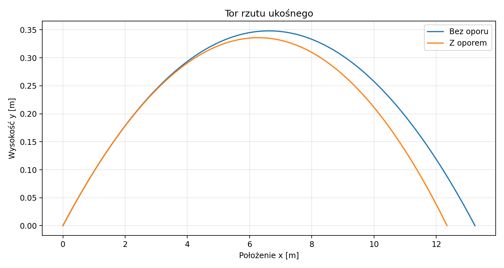
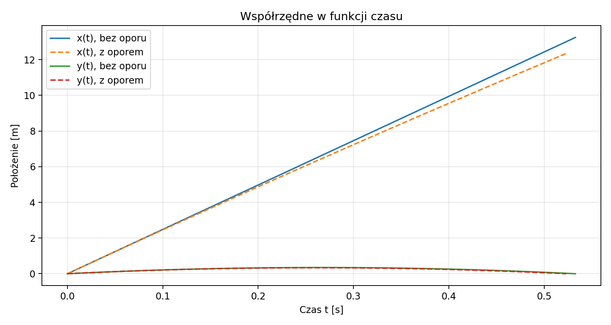
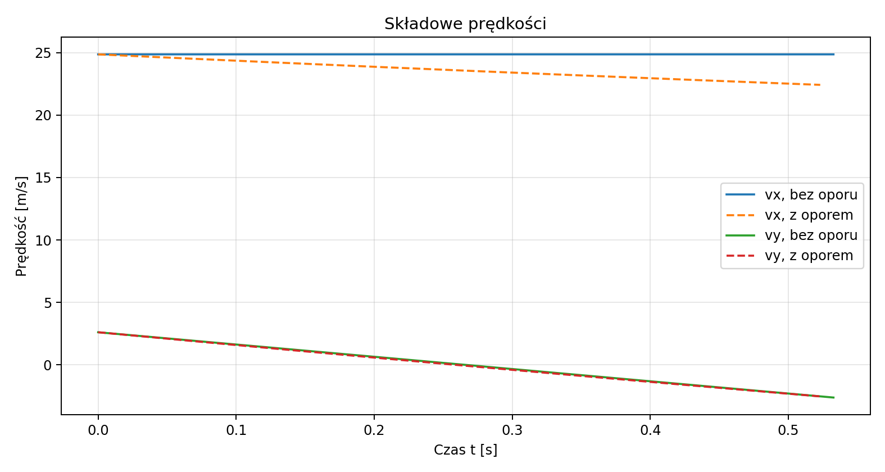
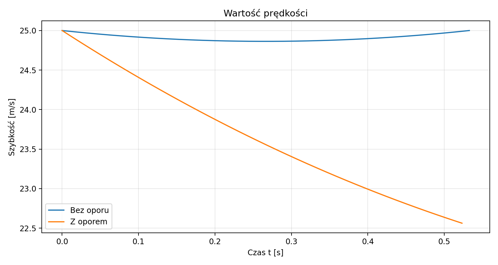
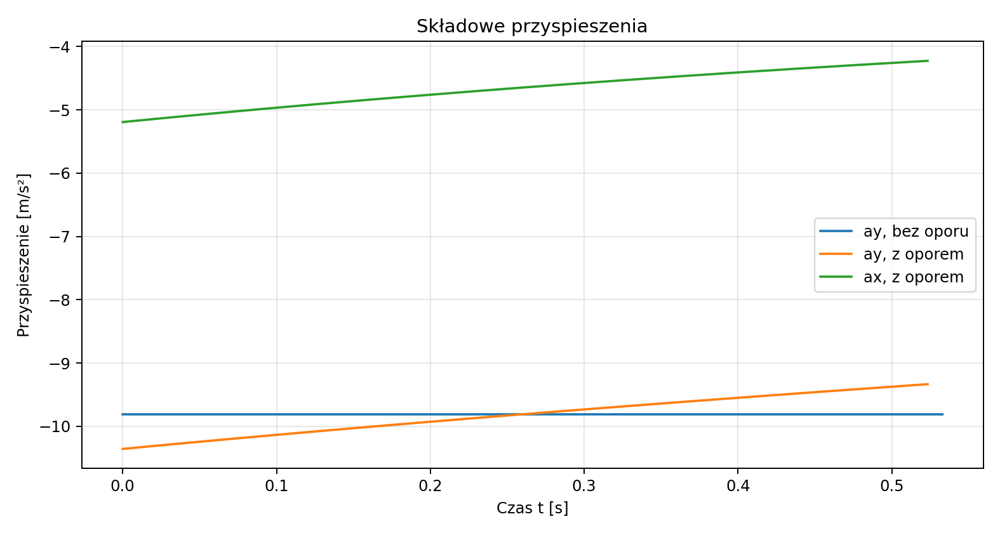
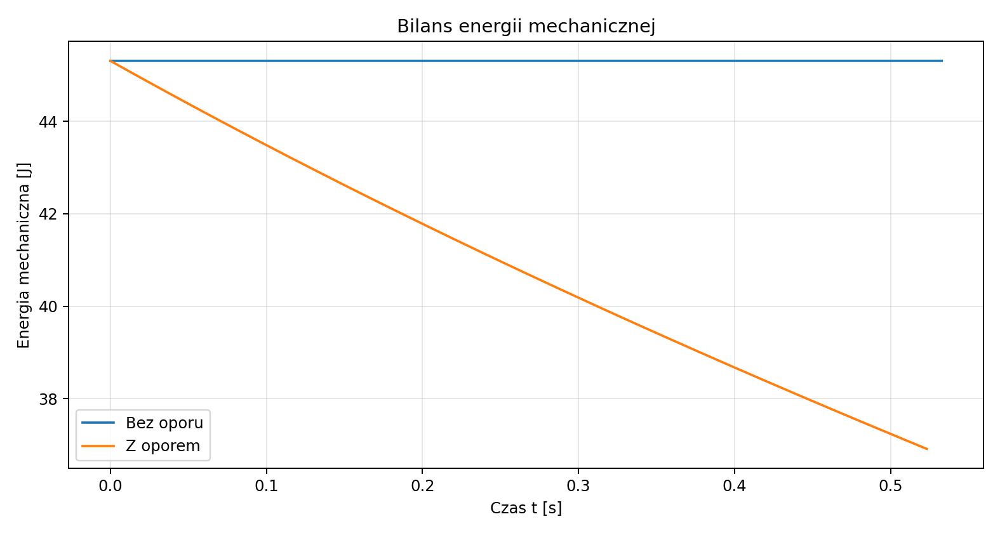

# Rzut ukośny — ruch bez oporu powietrza i z oporem

*Raport obliczeniowy: wyprowadzenia analityczne, rozwiązanie numeryczne oraz wizualizacja wyników w Pythonie.*

**Temat:** ruch ciała wyrzuconego pod kątem do poziomu.  
**Metoda:** druga zasada Newtona, całkowanie równań ruchu i symulacja numeryczna.  
**Charakter wyników:** obliczenia modelowe, nie pomiary laboratoryjne.

## Spis treści

1. [Cel i założenia](#1-cel-i-założenia)
2. [Rzut ukośny bez oporu powietrza](#2-rzut-ukośny-bez-oporu-powietrza)
3. [Rzut ukośny z oporem powietrza](#3-rzut-ukośny-z-oporem-powietrza)
4. [Porównanie wyników i wykresy](#4-porównanie-wyników-i-wykresy)
5. [Energia mechaniczna](#5-energia-mechaniczna)
6. [Kod źródłowy i odtwarzanie obliczeń](#6-kod-źródłowy-i-odtwarzanie-obliczeń)
7. [Wnioski](#7-wnioski)

---

## 1. Cel i założenia

Rzut ukośny jest ruchem dwuwymiarowym, w którym ciało otrzymuje prędkość początkową skierowaną pod kątem $\alpha$ do poziomu. Celem raportu jest opisanie tego ruchu w dwóch modelach: idealnym oraz uwzględniającym siłę oporu aerodynamicznego. Interesują nas w szczególności tor, czas lotu, zasięg, maksymalna wysokość, prędkość i energia mechaniczna.

Przyjmujemy płaską powierzchnię ziemi, jednorodne pole grawitacyjne i brak wiatru. Początek układu współrzędnych znajduje się w punkcie wyrzutu, oś $x$ jest pozioma, a oś $y$ pionowa i skierowana w górę. Ciało spada na poziom $y=0$. Nie analizujemy samego zderzenia z podłożem.

### 1.1. Warunki początkowe

Zgodnie z poleceniem wartości prędkości początkowej i kąta wybrano na podstawie cyfr numeru indeksu:

| Wielkość | Symbol | Wartość w SI |
| :--- | :---: | ---: |
| Prędkość początkowa | $v_0$ | $25\ \mathrm{m/s}$ |
| Kąt wyrzutu | $\alpha$ | $\pi/30\ \mathrm{rad}\approx0{,}10472\ \mathrm{rad}$ |
| Przyspieszenie ziemskie | $g$ | $9{,}81\ \mathrm{m/s^2}$ |
| Położenie początkowe | $(x_0,y_0)$ | $(0,0)\ \mathrm m$ |

Kąt $6^\circ$ podano wyłącznie pomocniczo, aby wskazać sposób wyznaczenia parametru; obliczenia wykonywane są w radianach.

Składowe prędkości początkowej wynoszą:

$$
\begin{aligned}
v_{0x}&=v_0\cos\alpha=25\cos(\pi/30)\approx24{,}8631\ \mathrm{m/s},\\
v_{0y}&=v_0\sin\alpha=25\sin(\pi/30)\approx2{,}6132\ \mathrm{m/s}.
\end{aligned}
$$

## 2. Rzut ukośny bez oporu powietrza

### 2.1. Równania Newtona

W modelu idealnym jedyną działającą siłą jest ciężar:

$$
\mathbf F_g=-mg\mathbf e_y.
$$

Z drugiej zasady Newtona $m\ddot{\mathbf r}=\mathbf F_g$ otrzymujemy po rozłożeniu na osie:

$$
\ddot x=0,\qquad \ddot y=-g.
$$

Całkując pierwsze równanie po czasie, uzyskujemy $\dot x=C_1$. Z warunku $\dot x(0)=v_{0x}$ wynika $C_1=v_{0x}$. Powtórne całkowanie, przy $x(0)=0$, daje

$$
\boxed{x(t)=v_0\cos\alpha\,t}.
$$

Podobnie z $\ddot y=-g$ wynika $\dot y=-gt+C_2$; warunek $\dot y(0)=v_{0y}$ daje $C_2=v_{0y}$. Uwzględnienie $y(0)=0$ prowadzi do

$$
\boxed{y(t)=v_0\sin\alpha\,t-\frac12gt^2}.
$$

Prędkość i przyspieszenie mają więc postać

$$
\begin{aligned}
v_x(t)&=v_0\cos\alpha,&v_y(t)&=v_0\sin\alpha-gt,\\
a_x(t)&=0,&a_y(t)&=-g.
\end{aligned}
$$

### 2.2. Równanie toru

Dla $v_0\cos\alpha\ne0$ można wyeliminować czas:

$$
t=\frac{x}{v_0\cos\alpha}.
$$

Po podstawieniu do równania $y(t)$ i wykorzystaniu $\tan\alpha=\sin\alpha/\cos\alpha$ otrzymujemy

$$
\boxed{y(x)=x\tan\alpha-\frac{g}{2v_0^2\cos^2\alpha}x^2}.
$$

Jest to parabola skierowana ramionami w dół.

### 2.3. Czas lotu, maksymalna wysokość i zasięg

Czas lotu $T$ wyznacza drugi, dodatni pierwiastek równania $y(T)=0$:

$$
T\left(v_0\sin\alpha-\frac12gT\right)=0
\quad\Longrightarrow\quad
\boxed{T=\frac{2v_0\sin\alpha}{g}}.
$$

W najwyższym punkcie $v_y(t_H)=0$, zatem

$$
t_H=\frac{v_0\sin\alpha}{g}=\frac T2.
$$

Wstawiając tę wartość do $y(t)$, dostajemy

$$
\boxed{H=\frac{v_0^2\sin^2\alpha}{2g}}.
$$

Zasięg jest równy $R=x(T)$. Stąd, po zastosowaniu $2\sin\alpha\cos\alpha=\sin(2\alpha)$,

$$
\boxed{R=\frac{v_0^2\sin(2\alpha)}{g}}.
$$

Wyniki dla zadanych warunków początkowych:

| Wielkość | Wynik |
| :--- | ---: |
| Czas lotu $T$ | $0{,}532765\ \mathrm s$ |
| Czas osiągnięcia wierzchołka $t_H$ | $0{,}266383\ \mathrm s$ |
| Maksymalna wysokość $H$ | $0{,}348057\ \mathrm m$ |
| Zasięg $R$ | $13{,}246158\ \mathrm m$ |

Ponieważ kąt jest mały, tor jest bardzo płaski: ciało pokonuje poziomo ponad $13\ \mathrm m$, a wznosi się na około $0{,}35\ \mathrm m$.

## 3. Rzut ukośny z oporem powietrza

### 3.1. Model oporu aerodynamicznego

W tym modelu, poza ciężarem, występuje siła przeciwna do chwilowej prędkości:

$$
\mathbf F_{\mathrm{op}}=-\frac12\rho C_d A\lVert\mathbf v\rVert\mathbf v=-k\lVert\mathbf v\rVert\mathbf v,
\qquad k=\frac12\rho C_d A.
$$

Przyjęty model kwadratowy jest przybliżeniem właściwym dla wielu przepływów przy stosunkowo dużych liczbach Reynoldsa. Parametry poniżej służą do ilustracji, ponieważ treść zadania nie podaje konkretnego ciała:

| Wielkość | Symbol | Wartość |
| :--- | :---: | ---: |
| Masa (przykładowa piłka) | $m$ | $0{,}145\ \mathrm{kg}$ |
| Promień | $r$ | $0{,}0366\ \mathrm m$ |
| Pole przekroju | $A=\pi r^2$ | $\approx0{,}004208\ \mathrm{m^2}$ |
| Gęstość powietrza | $\rho$ | $1{,}225\ \mathrm{kg/m^3}$ |
| Współczynnik oporu | $C_d$ | $0{,}47$ (bezwymiarowy) |
| Parametr oporu | $k$ | $\approx0{,}00121148\ \mathrm{kg/m}$ |

W praktyce $C_d$ może zależeć od prędkości, chropowatości i ruchu obrotowego. Te efekty pomijamy.

### 3.2. Wyprowadzenie równań ruchu

Zapisujemy wektor prędkości jako $\mathbf v=(v_x,v_y)$; jego wartość to

$$
\lVert\mathbf v\rVert=\sqrt{v_x^2+v_y^2}.
$$

Druga zasada Newtona prowadzi do

$$
m\ddot{\mathbf r}=-mg\mathbf e_y-k\lVert\dot{\mathbf r}\rVert\dot{\mathbf r}.
$$

Po rozpisaniu na składowe i podzieleniu przez masę:

$$
\boxed{\begin{aligned}
\dot x&=v_x,\\
\dot y&=v_y,\\
\dot v_x&=-\frac{k}{m}\sqrt{v_x^2+v_y^2}\,v_x,\\
\dot v_y&=-g-\frac{k}{m}\sqrt{v_x^2+v_y^2}\,v_y.
\end{aligned}}
$$

Warunki początkowe są identyczne jak w modelu idealnym:

$$
\big(x(0),y(0),v_x(0),v_y(0)\big)
=\big(0,0,v_0\cos\alpha,v_0\sin\alpha\big).
$$

Jest to nieliniowy układ równań różniczkowych pierwszego rzędu. Zamiast zakładać paraboliczny tor, rozwiązujemy go numerycznie za pomocą `scipy.integrate.solve_ivp`. Koniec lotu wyznacza pierwsze przecięcie $y=0$ z ujemną prędkością pionową. Początkowy punkt $y(0)=0$ nie jest traktowany jako lądowanie.

### 3.3. Wyniki numeryczne

Dla wybranego modelu ciała uzyskano:

| Wielkość | Bez oporu | Z oporem |
| :--- | ---: | ---: |
| Czas lotu [s] | 0,532765 | 0,523258 |
| Maksymalna wysokość [m] | 0,348057 | 0,335845 |
| Zasięg [m] | 13,246158 | 12,348942 |

Opór skraca zasięg i zmniejsza maksymalną wysokość. W tym przypadku zmniejsza także czas lotu. Ostatnia zależność nie jest jednak uniwersalną regułą dla wszystkich warunków początkowych i modeli oporu.

## 4. Porównanie wyników i wykresy

Wykresy zostały wygenerowane przez dołączony program `generuj_wykresy.py`. Każdy wykres przedstawia obliczenia dla tych samych warunków początkowych i jest ograniczony do odpowiedniego momentu lądowania.

### 4.1. Tory ruchu



*Rysunek 1. Obie trajektorie zaczynają się w tym samym punkcie i z tą samą prędkością. Opór zmniejsza zarówno zasięg, jak i wysokość.*

### 4.2. Położenie w czasie



*Rysunek 2. Bez oporu współrzędna pozioma rośnie liniowo. Przy oporze prędkość pozioma maleje, dlatego $x(t)$ przestaje być funkcją liniową.*

### 4.3. Składowe prędkości



*Rysunek 3. W modelu idealnym $v_x$ pozostaje stała, a $v_y$ maleje liniowo. W modelu z oporem obie składowe zmieniają się nieliniowo.*

### 4.4. Wartość prędkości



*Rysunek 4. Podczas wznoszenia szybkość maleje. Bez oporu szybkość przy lądowaniu na tej samej wysokości jest równa początkowej; z oporem jest mniejsza.*

### 4.5. Przyspieszenie



*Rysunek 5. W modelu idealnym przyspieszenie wynosi $(0,-g)$. Z oporem pojawia się pozioma składowa przyspieszenia, a pionowa zależy od prędkości.*

## 5. Energia mechaniczna

Energia kinetyczna, potencjalna grawitacji i całkowita energia mechaniczna są równe

$$
E_k=\frac12m(v_x^2+v_y^2),\qquad E_p=mgy,\qquad E=E_k+E_p.
$$

Różniczkując po czasie:

$$
\begin{aligned}
\frac{dE}{dt}
&=m\mathbf v\cdot\dot{\mathbf v}+mg\dot y\\
&=\mathbf v\cdot(m\dot{\mathbf v}+mg\mathbf e_y)\\
&=\mathbf v\cdot\mathbf F_{\mathrm{op}}\\
&=-k\lVert\mathbf v\rVert^3\leq0.
\end{aligned}
$$

Dla $k=0$ energia jest stała, natomiast przy $k>0$ maleje na skutek pracy siły oporu. Spadek energii mechanicznej wiąże się m.in. z jej przekazywaniem do otaczającego powietrza.



*Rysunek 6. Energia mechaniczna bez oporu pozostaje stała, natomiast z oporem maleje. Początkowo w obu przypadkach $E(0)=45{,}3125\ \mathrm J$.*

## 6. Kod źródłowy i odtwarzanie obliczeń

Kompletny kod umieszczono w pliku [`generuj_wykresy.py`](generuj_wykresy.py), dołączonym w tym samym folderze co raport. Program oblicza oba rozwiązania i zapisuje sześć wykresów do katalogu `files/`.

Główna funkcja opisująca układ równań ma postać:

```python
def rhs(t, q):
    x, y, vx, vy = q
    v = np.hypot(vx, vy)
    return [vx, vy, -(k/m)*v*vx, -g-(k/m)*v*vy]
```

Rozwiązanie numeryczne uzyskujemy przez:

```python
sol = solve_ivp(
    rhs, (0, 5), q0,
    events=ground,
    dense_output=True,
    rtol=1e-10,
    atol=1e-12,
    max_step=0.002
)
```

Do odtworzenia wykresów potrzebne są biblioteki `numpy`, `scipy` oraz `matplotlib`. Można je zainstalować poleceniem:

```bash
python -m pip install numpy scipy matplotlib
```

Następnie uruchomić program z folderu raportu:

```bash
python generuj_wykresy.py
```

Pliki PNG powstaną w podfolderze `files`. Sam plik Markdown należy przeglądać przy użyciu podglądu Markdown w Visual Studio Code lub na GitHub.

## 7. Wnioski

1. W jednorodnym polu grawitacyjnym, bez oporu powietrza, rzut ukośny ma tor paraboliczny, a składowa pozioma prędkości jest stała.
2. Przy uwzględnieniu kwadratowego oporu powietrza ruch opisuje nieliniowy układ równań różniczkowych. Jego rozwiązanie obliczono numerycznie.
3. Dla prędkości początkowej $25\ \mathrm{m/s}$ i kąta $\pi/30\ \mathrm{rad}$ zasięg maleje z około $13{,}25\ \mathrm m$ do $12{,}35\ \mathrm m$ w przyjętym modelu oporu.
4. Bez oporu energia mechaniczna jest zachowana. Z oporem jest nierosnąca, zgodnie z zależnością $dE/dt=-k\lVert\mathbf v\rVert^3$.
5. Wyniki liczbowe zależą od przyjętych parametrów aerodynamicznych. W szczególności nie należy ich interpretować jako uniwersalnych dla wszystkich wyrzucanych przedmiotów.

### Źródła i dokumentacja

- [OpenStax University Physics, Projectile Motion](https://openstax.org/books/university-physics-volume-1/pages/4-3-projectile-motion)
- [SciPy — solve_ivp](https://docs.scipy.org/doc/scipy/reference/generated/scipy.integrate.solve_ivp.html)
- [Matplotlib — dokumentacja](https://matplotlib.org/stable/)

